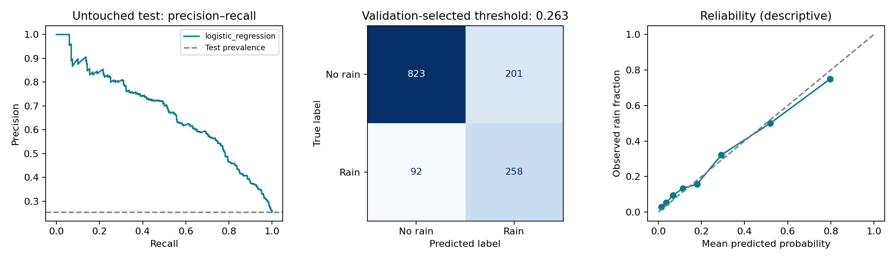

# Next-day rainfall prediction

**Can a model identify tomorrow's rain using observations available by the end of today?** This project compares logistic regression and random forests for three Melbourne-area weather stations, with an evaluation that follows calendar time.

Jihad Boussata · Python · pandas · scikit-learn · temporal validation



## Result

| Untouched test metric | Logistic regression | Training-prior baseline |
| --- | --- | --- |
| ROC AUC | 0.835 | 0.500 |
| Average precision | 0.670 | 0.255 |
| Balanced accuracy | 0.770 | 0.500 |
| Rain recall | 0.737 | 0.000 |
| Brier score (lower is better) | 0.132 | 0.190 |

The test set contains 1,374 observations from March 2016 to June 2017. Rain prevalence is 25.5%. The probability threshold, 0.263, maximizes F1 on validation data. It produces recall 73.7% with precision 56.2%; this is an explicit operating tradeoff. Probabilities and metrics are committed in [results/](results/).

## Reproduce

Use Python 3.12. Create and activate a virtual environment, then run from this directory:

```bash
python -m pip install -r requirements.txt
python -m unittest discover -s tests -v
python -m rainfall.train
```

The first run downloads the documented IBM course CSV and checks its SHA-256. To use the exact snapshot offline, place it at `data/raw/weatherAUS.csv`. Outputs go to `results/`; use `--output another-directory` to keep a separate run.

## Evaluation design

| Set | Rows | Dates | Period |
| --- | --- | --- | --- |
| train | 6068 | 2235 | 2008-07-01 → 2014-11-10 |
| validation | 1001 | 479 | 2014-11-11 → 2016-03-03 |
| test | 1374 | 479 | 2016-03-04 → 2017-06-25 |

- Keep the source target `RainTomorrow`; `RainToday` remains a predictor with its original meaning.
- Restrict to Melbourne, MelbourneAirport and Watsonia. Drop missing targets, retain missing predictors and learn imputation inside the training pipeline.
- Split unique dates 70/15/15; all stations on a date stay together. Expanding-window cross-validation uses three training-only folds with a one-observed-date gap.
- Select hyperparameters by cross-validated average precision. Validation average precision selects the model; validation F1 selects its threshold.
- Freeze the training-fitted model and threshold, then evaluate test once. There is no refit on validation.

## Contents and limits

`rainfall/data.py` handles acquisition, features and date splits. `rainfall/train.py` contains the fitted preprocessing pipelines, model selection and reporting. `tests/` checks date separation, training-only imputation, unseen categories and target exclusion.

These are retrospective 2008–2017 station observations, with missingness and local coverage. The model is an end-of-day forecast, including 3 p.m. variables. It is not an early-morning forecast or an operational weather service. Scores do not establish performance at unseen locations or in today's climate. The reliability chart describes calibration; it is not a fitted calibration model.

## Origin and attribution

Reworked from my IBM machine-learning rainfall coursework. The underlying weatherAUS data is associated with the [Rattle weather dataset](https://rattle.togaware.com/weatherAUS.csv) and the Australian Bureau of Meteorology; this run uses the [IBM-hosted course snapshot](https://cf-courses-data.s3.us.cloud-object-storage.appdomain.cloud/_0eYOqji3unP1tDNKWZMjg/weatherAUS-2.csv). Raw data is downloaded locally and is not redistributed in this repository. See [data/README.md](data/README.md), [methodology](docs/METHODOLOGY.md) and [changes](docs/CHANGES.md). New portfolio code is MIT licensed; source data retains its own terms.
